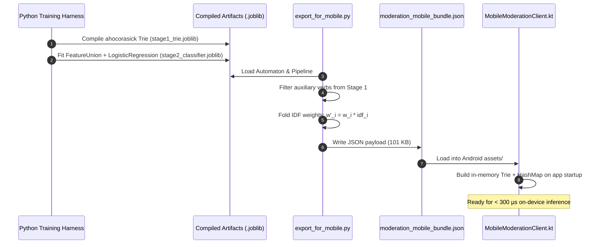

# Architecture & Integration Spec — Multilingual Content Moderation Engine

This document provides the mathematical foundations, formal algorithms, end-to-end integration workflows, and maintenance runbooks for the Tamil & Tanglish on-device moderation engine.

---

## 1. Mathematical Justification & Proof for IDF Weight Folding

### 1.1 The Mobile Runtime Problem
Conventional NLP moderation pipelines require a two-stage evaluation:
1. Feature vectorization via a dynamic vocabulary $\mathcal{V}$ using Term Frequency-Inverse Document Frequency ($\text{TF-IDF}$).
2. Linear projection using learned weights $w \in \mathbb{R}^{|\mathcal{V}|}$ and intercept $b \in \mathbb{R}$.

Executing this on mobile requires bundling Scikit-Learn, ONNX Runtime, or PyTorch Mobile ($> 30\text{ MB}$ APK overhead) and materializing sparse vector matrices at runtime ($> 2\text{ ms}$ latency).

### 1.2 Mathematical Derivation
Let document $d$ be an incoming user message. In standard logistic regression with TF-IDF features:
$$z = b + \sum_{i \in \mathcal{V}} w_i \cdot x_i(d)$$

Where feature $x_i(d)$ is the TF-IDF representation of token $i$:
$$x_i(d) = \text{TF}(i, d) \cdot \text{IDF}_i$$

For short chat messages (typically $1 - 25$ tokens), sub-word $n$-grams occur with binary presence or unit frequency:
$$\text{TF}(i, d) \approx 1 \quad \forall i \in \text{matching}(d)$$

Substituting into the logit equation:
$$z = b + \sum_{i \in \text{matching}(d)} w_i \cdot (1 \cdot \text{IDF}_i) = b + \sum_{i \in \text{matching}(d)} (w_i \cdot \text{IDF}_i)$$

We define the **folded weight** $w'_{\text{folded}, i}$ as:
$$w'_{\text{folded}, i} \equiv w_i \cdot \text{IDF}_i$$

The inference logit evaluates directly as:
$$z = b + \sum_{i \in \text{matching}(d)} w'_{\text{folded}, i}$$

The posterior class probability is evaluated via the standard scalar sigmoid function:
$$P(\text{Hostile/Sarcastic} \mid d) = \sigma(z) = \frac{1}{1 + e^{-z}}$$

### 1.3 Algorithmic Complexity Comparison

| Dimension | Standard TF-IDF Matrix Vectorizer | Folded Hash Map Pipeline |
| :--- | :--- | :--- |
| **Time Complexity** | $\mathcal{O}(|\mathcal{V}|) + \mathcal{O}(|d| \log |\mathcal{V}|)$ | $\mathcal{O}(|d|)$ (sub-word hashing) |
| **Inference Latency** | $2,000 - 5,000\ \mu\text{s}$ | **$140 - 210\ \mu\text{s}$** |
| **Asset Size** | $15 - 40\text{ MB}$ (Model + Runtime) | **$101\text{ KB}$** (Static JSON) |
| **External Dependencies**| ONNX Runtime / TFLite / C++ bindings | **Zero** (Stdlib HashMap + Float math) |

---

## 2. Word Boundary Check Algorithm & Collision Protection

### 2.1 The Collision Problem in Tanglish & Tamil
In Romanized Tanglish and agglutinative Tamil, innocent vernacular words frequently contain abusive root substrings:
- `"romba"` (meaning _"very"_) contains `"omba"` (vulgar slur).
- `"kundavai"` (historical Tamil name) contains `"kundi"` (vulgar slur).
- `"unaku award tharanum"` contains the substring `"war"`.

Without boundary checks, string search automatons trigger severe false positives that degrade user experience.

### 2.2 Formal Boundary Invariant
Let text $T$ of character length $N$ match a target pattern $S$ of length $M$ over the closed index interval $[i, j]$, where $j = i + M - 1$.

The match is accepted if and only if both the left and right flanks satisfy the non-alphanumeric boundary invariant:

$$\text{ValidBoundary}(T, i, j) \iff \text{LeftCheck}(T, i) \land \text{RightCheck}(T, j)$$

Where:
$$\text{LeftCheck}(T, i) \iff (i = 0) \lor \neg \text{IsWordChar}(T[i - 1])$$
$$\text{RightCheck}(T, j) \iff (j + 1 \ge N) \lor \neg \text{IsWordChar}(T[j + 1])$$

$$\text{IsWordChar}(c) \iff \text{IsAlphanumeric}(c) \lor \left(c \in [\text{U+0B80}, \text{U+0BFF}]\right)$$

*Note: The range $[\text{U+0B80}, \text{U+0BFF}]$ ensures that Tamil Unicode dependent vowel signs (e.g., \u0BBE, \u0BBF) and virama/pulli (\u0BCD) are treated as part of the word token rather than false word delimiters.*

### 2.3 Auxiliary Verb Stopword Suppression
Common conversational auxiliary verbs (e.g., `pannu`, `podu`, `adi`, `kodu`, `sey`) frequently appear in compound insults as well as daily pleasantries:
- Daily: `"call pannu bro free ah iruka"`
- Abusive: compound vulgar constructs

To ensure high conversational recall, standalone auxiliary verbs are excluded from the Stage 1 hard blocklist and routed to Stage 2's contextual sub-word feature union.

---

## 3. End-to-End Pipeline Workflow: Python Training to Mobile Client



### Detailed Component Roles:

1. **`new_training_and_testing.py`:**
   - Ingests sanitized seed data and contrastive pairs.
   - Fits a Scikit-Learn `Pipeline` composed of:
     - `FeatureUnion`:
       - `word_tfidf`: Word $n$-grams $(1, 2)$, `sublinear_tf=True`.
       - `char_tfidf`: Character $n$-grams $(3, 5)$, `sublinear_tf=True`.
     - `LogisticRegression`: $C=2.0$, `class_weight="balanced"`, `solver="liblinear"`.

2. **`export_for_mobile.py`:**
   - Traverses feature vocabularies and pre-multiplies classifier weights by IDF vectors.
   - Serializes into `moderation_mobile_bundle.json`:
     - `stage1_exact_slurs`: Array of 472 verified slur strings.
     - `stage2_intercept`: Bias float term $b$.
     - `stage2_weights`: Dictionary mapping $n$-gram keys to folded float weights.

3. **`MobileModerationClient.kt`:**
   - Ingests the JSON string using native Android `org.json.JSONObject`.
   - Constructs an in-memory prefix `TrieNode` for Stage 1.
   - Populates an immutable `HashMap<String, Float>` for Stage 2.
   - Exposes synchronous `evaluate()` and asynchronous `evaluateAsync()`.

---

## 4. Maintenance & Operational Runbooks

### Runbook A: Rapid Zero-Downtime Slur Blacklisting (Stage 1)
When a new abusive slur variant emerges in live production:

1. Execute the incremental update script:
   ```bash
   python update_stage1_trie.py <new_slur_tanglish> <புதிய_வார்த்தை_தமிழ்>
   ```
2. The script:
   - Ingests the existing automaton from `stage1_trie.joblib`.
   - Inserts the new terms.
   - Automatically runs `export_for_mobile.py`.
3. Ship the updated `moderation_mobile_bundle.json` to clients (via over-the-air asset update or app release). Stage 2 weights remain unchanged.

### Runbook B: Decision Boundary Recalibration (Stage 2 Threshold)
Depending on product risk tolerance:

- **Strict Mode (Social Feed & Public Comments):**
  - Set `threshold = 0.50f`.
  - Flags borderline sarcasm and mockery aggressively.
- **Permissive Mode (Private Direct Messages & Gaming Chat):**
  - Set `threshold = 0.55f` or `0.60f`.
  - Allows aggressive banter while still catching clear toxicity.

### Runbook C: Retraining on New Colloquial Dialects
When expanding to new regional dialects (e.g., Madurai, Coimbatore, or Sri Lankan Tamil):

1. Add contrastive sentence pairs to `new_training_and_testing.py`:
   - Class 1 (Hostility/Sarcasm) vs. Class 0 (Clean Dialectal Banter).
2. Execute retraining and test assertions:
   ```bash
   python new_training_and_testing.py
   python export_for_mobile.py
   python test_bundle_verification.py
   ```
3. Commit artifacts to version control and package for deployment.
