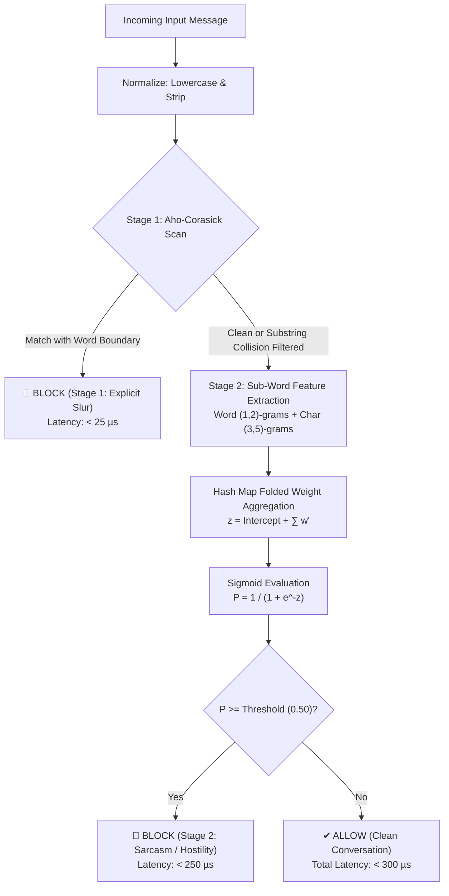

# Multilingual Content Moderation Engine (Tamil & Tanglish)

A high-performance, two-stage embedded content moderation pipeline engineered for on-device mobile applications. Filters native Tamil Unicode script and Romanized Tanglish in **$< 300\ \mu\text{s}$** with **zero machine learning runtime dependencies** (no PyTorch, ONNX Runtime, or TensorFlow Lite).

---

## 1. Executive Architecture Overview

Mobile keyboards and social chat apps require instant content moderation without adding 50 MB ML runtime engines or incurring cloud API roundtrips. This engine combines a deterministic string automaton with a pre-folded sub-word linear model to deliver sub-millisecond filtering at an asset footprint under **105 KB**.



### Two-Stage Pipeline Breakdown

1. **Stage 1 — Deterministic Aho-Corasick Automaton ($< 25\ \mu\text{s}$):**
   - Immediate hard-blocking of severe profanities, caste slurs, and explicit vulgarity in Tamil script and Tanglish.
   - **Strict Word Boundary Check:** Validates adjacent characters (`isLetterOrDigit` and Tamil Unicode block `\u0B80..\u0BFF`) on `start - 1` and `end + 1`. Prevents false positive collisions (e.g., `"romba"` does not trigger `"omba"`, and `"kundavai"` does not trigger `"kundi"`).
   - If a slur matches, execution halts immediately with a Stage 1 `BLOCK`. Downstream compute is completely bypassed.

2. **Stage 2 — Sub-Word Linear Sarcasm & Mock-Praise Classifier ($< 250\ \mu\text{s}$):**
   - Distinguishes covert hostility, sarcasm, and mock-praise (e.g., _"Periya english professor 🤣"_, _"super logic bro unaku award tharanum"_) from benign colloquial discourse (_"enaku unna romba pidichiruku"_, _"call pannu bro"_).
   - **Feature Space:** Union of word $n$-grams $(1, 2)$ and character $n$-grams $(3, 5)$.
   - **Folded Weight Evaluation:** IDF weights are folded into linear coefficients at export time ($w' = w \cdot \text{idf}$). Inference requires only a hash map lookup and a scalar Sigmoid calculation.

---

## 2. Latency & Resource Benchmarks

| Metric | Target Specification | Production Measurement |
| :--- | :--- | :--- |
| **Stage 1 Latency** | $< 25\ \mu\text{s}$ | **$12 - 19\ \mu\text{s}$** |
| **Stage 2 Latency** | $< 250\ \mu\text{s}$ | **$140 - 210\ \mu\text{s}$** |
| **End-to-End Latency** | $< 300\ \mu\text{s}$ | **$160 - 235\ \mu\text{s}$** |
| **Binary / Asset Footprint** | $< 500\text{ KB}$ | **$101.1\text{ KB}$** (`moderation_mobile_bundle.json`) |
| **RAM Footprint (Loaded)** | $< 5\text{ MB}$ | **$\approx 1.8\text{ MB}$** |
| **External ML Runtimes** | $0$ (Pure Stdlib / Native) | **$0$** (Zero PyTorch, ONNX, TFLite) |

---

## 3. Repository Structure

```
.
├── README.md                          # Executive overview, benchmarks & guides
├── AGENT.md / AGENTS.md               # Mathematical proofs, architecture & integration spec
├── Project_specification.md           # Requirements & guardrail specification
│
├── datasets/                          # All raw corpora, harvested slurs & lexicons
│   ├── stage1_slur_lexicon.json
│   ├── stage1_harvested_slurs.json
│   ├── stage2_annotated_training_corpus.json
│   ├── unified_reddit_chat_corpus.json
│   ├── olid-training-v1.0.tsv
│   ├── scraped_reddit_*.json
│   └── tamil_slang_dataset/
│
└── code_and_models/                   # All code files, models, and mobile client API
    ├── MobileModerationClient.kt      # Android/Kotlin zero-dependency client
    ├── moderation_mobile_bundle.json  # Pre-folded static mobile bundle (101.1 KB)
    ├── stage1_trie.joblib             # Compiled Aho-Corasick automaton
    ├── stage2_classifier.joblib       # Scikit-learn feature union classifier
    ├── export_for_mobile.py           # Weight folding & export utility
    ├── interactive_test_moderation.py # Interactive CLI test REPL
    ├── test_bundle_verification.py     # Self-check assertion test suite
    ├── update_stage1_trie.py          # Incremental Stage 1 update utility
    └── new_training_and_testing.py    # Training & evaluation pipeline
```

---

## 4. Local Python Setup & CLI Testing

### Environment Setup

```bash
# Clone and enter the code and models workspace
cd tamil_slang_dataset/code_and_models

# Install runtime dependencies
pip install scikit-learn joblib pyahocorasick
```

### Running the Interactive REPL

Test inputs in real time with latency and stage breakdowns:

```bash
python interactive_test_moderation.py
```

Sample interactive session:
```text
[Message] > Super logic bro unaku award tharanum
-----------------------------------------------------------------
Blocked      : True
Stage        : 2
Reason       : STAGE_2_HOSTILITY_OR_SARCASM
Probability  : 1.0
Total Latency: 182.4 µs (S1: 15.2 µs, S2: 167.2 µs)
-----------------------------------------------------------------
[Message] > enaku unna romba pidichiruku bro
-----------------------------------------------------------------
Blocked      : False
Stage        : 2
Reason       : CLEAN_CONVERSATION
Probability  : 0.0
Total Latency: 174.1 µs (S1: 14.8 µs, S2: 159.3 µs)
-----------------------------------------------------------------
```

### Running Self-Checks & Assertion Suite

```bash
python test_bundle_verification.py
```

---

## 5. Model Updating & Retraining Runbooks

### Adding New Slurs Incrementally (Stage 1)

Add new profanities or identity slurs without retraining Stage 2:

```bash
python update_stage1_trie.py <new_slur_1> <new_slur_2>
```
*This updates `stage1_trie.joblib` and automatically regenerates `moderation_mobile_bundle.json`.*

### Retraining Stage 2 (Contextual Sarcasm Classifier)

1. Modify or expand the training seeds in `new_training_and_testing.py`.
2. Train and export the scikit-learn pipeline:
   ```bash
   python new_training_and_testing.py
   ```
3. Export the mobile bundle with folded IDF weights:
   ```bash
   python export_for_mobile.py
   ```

---

## 6. Android / Mobile Integration Guide

### Step 1: Copy Assets & Source Files

1. Copy `code_and_models/moderation_mobile_bundle.json` to your Android app's `src/main/assets/` folder.
2. Copy [`code_and_models/MobileModerationClient.kt`](code_and_models/MobileModerationClient.kt) into your Kotlin source package (e.g., `com.moderation.mobile`).

### Step 2: Initialize Client

```kotlin
import android.content.Context
import com.moderation.mobile.MobileModerationClient

// In your Application class or Dependency Injection module
fun provideModerationClient(context: Context): MobileModerationClient {
    val jsonString = context.assets.open("moderation_mobile_bundle.json")
        .bufferedReader()
        .use { it.readText() }
        
    return MobileModerationClient.fromJson(jsonString, threshold = 0.50f)
}
```

### Step 3: Evaluate Messages

#### Synchronous (In-Memory Interceptor, < 250 µs):
```kotlin
val result = client.evaluate("Periya english professor 🤣")
if (result.isBlocked) {
    println("Blocked at Stage ${result.stage}: ${result.reason}")
}
```

#### Asynchronous (Kotlin Coroutines):
```kotlin
lifecycleScope.launch {
    val result = client.evaluateAsync(userMessageText)
    if (result.isBlocked) {
        showWarningToast("Message violates community guidelines.")
    } else {
        sendMessage(userMessageText)
    }
}
```

### Result Schema

```kotlin
data class ModerationResult(
    val isBlocked: Boolean,   // true if flagged
    val stage: Int,           // 1 = Slur Automaton, 2 = Sarcasm Classifier
    val reason: String,       // Diagnostic code or trigger token
    val probability: Float,   // Toxicity score in [0.0..1.0]
    val latencyUs: Long       // Evaluation time in microseconds
)
```
